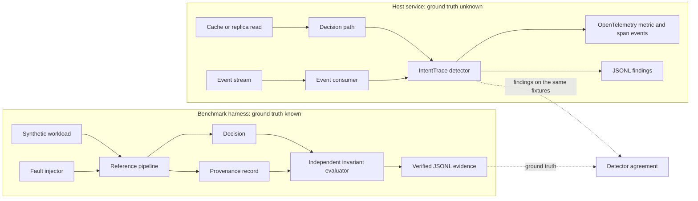

# IntentTrace

[](https://github.com/syellanki09/intenttrace/actions/workflows/ci.yml)

An open, nonproprietary reliability and evaluation framework for detecting, reproducing, tracing, and benchmarking **hidden information-integrity failures** in personalization, recommendation, and increasingly AI-enabled distributed systems.

Every service can report healthy while the decision a user sees was made on stale, missing, late, duplicated, conflicting, or misinterpreted information. Such failures leave no crash and no error to measure. IntentTrace provides two things for them:

- **A benchmark harness** that injects each failure deterministically into a clean-room reference pipeline, judges the outcome against independent ground truth, and packages verifiable evidence.
- **A runtime detector** that a host service runs itself, reporting the same failure classes from evidence the host already has and publishing findings through OpenTelemetry.

## How it works



The evaluator and the detector share no state. The harness knows the truth because it controls every input; the detector sees only what a host would see. The agreement runner compares the two on the same fixtures, so detection is measured rather than assumed.

## Failure classes and coverage

The six classes are defined in the [failure taxonomy](docs/failure-taxonomy.md).

| Class | What goes wrong | Executable scenario | Runtime check | In agreement run |
| --- | --- | --- | --- | --- |
| `stale-context` | Decision uses superseded context | [Stale context](docs/reference-results.md), [event-time ordering](docs/event-time-ordering.md) | `FreshnessCheck`, `EventTimeMonitor` | Yes |
| `missing-context` | Expected context absent; defaults used | Not yet | `FreshnessCheck` | No |
| `delayed-events` | Context arrives after the decision that needed it | [Event-time ordering](docs/event-time-ordering.md) | `EventTimeMonitor` | Yes |
| `duplicate-replay` | The same event is applied more than once | [Duplicate replay](docs/duplicate-replay.md) | `ReplayGuard` | Yes |
| `conflicting-values` | Sources disagree and the conflict is resolved silently | Not yet | `ReplayGuard`, `FreshnessCheck` | No |
| `contract-incompatibility` | Producer and consumer disagree on shape or meaning | [Contract unit drift](docs/contract-compatibility.md) | Not yet | No |

The agreement run covers nine fixed synthetic cases, true negatives included, listed in the [detector guide](docs/detector.md). It shows the checks behave as designed; it does not measure production precision or recall.

## Quick start

From a clean Git checkout with JDK 17, Python 3.9+, and network access for dependencies:

```bash
python3 tools/run_suite.py
./gradlew :benchmarks:runDetectorAgreement --no-daemon
```

The first command builds and tests the project, runs all four experiment families, independently verifies their 12 case results, and prints the location of `suite.zip` and a JSON summary under `build/suite/`. The second compares detector findings with ground truth. See the [suite walkthrough](docs/scenario-suite.md) for outcomes, archive contents, and offline verification.

For the published `v0.1.0-preview.1`, check out that tag and use its five-case `python3 tools/run_preview.py` command.

## Use the detector in a service

```kotlin
dependencies {
    implementation("io.github.syellanki09:intenttrace-detector-otel:0.1.0-preview.2")
}
```

```kotlin
val detector = IntentTraceDetector(
    sinks = listOf(OpenTelemetryFindingSink(openTelemetry)),
    freshness = FreshnessCheck(oracle = { key, at -> primary.latestVersion(key, at) }),
    replay = ReplayGuard(retention = Duration.ofHours(1)),
)

// After reading context from a cache or replica:
detector.checkDecision(ContextRead(requestId, userId, now, VersionStamp(read.version, read.committedAt)))
```

These coordinates resolve once preview 2 is published to Maven Central. The [detector guide](docs/detector.md) covers every check, the OpenTelemetry output, and the limits. The [consumer example](examples/detector-consumer/README.md) is a complete service built only from the library artifacts, and CI builds it on every change. The detector is experimental and its API may change.

## Experiments

| Family | Cases | Expected statuses | Run | Verify |
| --- | --- | --- | --- | --- |
| [Stale context](docs/reference-results.md) | 2 | SATISFIED, VIOLATED | `./gradlew :benchmarks:run` | `tools/verify_results.py` |
| [Contract unit drift](docs/contract-compatibility.md) | 3 | SATISFIED, VIOLATED, VIOLATED | `./gradlew :benchmarks:runContractScenario` | `tools/verify_contract_results.py` |
| [Duplicate replay](docs/duplicate-replay.md) | 3 | SATISFIED, VIOLATED, SATISFIED | `./gradlew :benchmarks:runReplayScenario` | `tools/verify_replay_results.py` |
| [Event-time ordering](docs/event-time-ordering.md) | 4 | SATISFIED, VIOLATED, SATISFIED, VIOLATED | `./gradlew :benchmarks:runEventTimeScenario` | `tools/verify_event_time_results.py` |

Each verifier takes the JSONL file its run writes under `benchmarks/build/results/`. Every record carries context evidence, the full source commit, whether the tree was dirty, and `detected: null`, because benchmark ground truth is recorded separately from detection. Repeated runs on the same checkout produce identical results. The [consolidated reference results](docs/reference-results.md) give invariants, inputs, comparisons, and limitations, and the [reproduction guide](docs/reproduction.md) covers clean-checkout verification, CI evidence bundles, and offline archive checks.

## Design constraints

- **Synthetic data only.** All workloads, events, and reference architectures are generated or clean-room constructed. No proprietary system data, configuration, or employer-derived material is used anywhere in this repository.
- **Open technologies.** No dependency on any commercial personalization platform.
- **Reproducible by others.** Every benchmark scenario is intended to be runnable end to end by an independent reader from a clean checkout.

A second focus is **shared SDKs and data contracts**, which can propagate versioning, compatibility, or context-handling problems to many client applications at once. The contract evaluator compares outcomes for the same logical input across producer and consumer.

## Repository layout

```
docs/                  failure taxonomy, architecture, methodology, per-experiment guides
pipeline/              clean-room reference personalization pipeline
injectors/             deterministic fault injectors
evaluation/            independent invariant evaluation and detection observations
provenance/            structured decision evidence and JSON serialization
benchmarks/            executable scenarios, JSONL output and detector agreement
detector/              runtime detector for host systems (no dependencies)
detector-otel/         OpenTelemetry metrics and span events for detector findings
examples/              outside consumer of the published detector artifacts
tools/                 independent Python verifiers, suite runner and release tooling
```

See the [architecture notes](docs/architecture.md) for each component and the [roadmap](ROADMAP.md) for planned work.

## Status

Experimental preview under active development. Four experiment families with 12 cases and the runtime detector are implemented and verified in CI. Executable scenarios for missing context and conflicting values, and a runtime contract check, are not yet implemented. No external adoption or third-party use is claimed.

## Releases and citation

Versioned evidence is available with the [experimental preview](https://github.com/syellanki09/intenttrace/releases/tag/v0.1.0-preview.1). Release validation is tracked in the [preview checklist](docs/release-checklist.md) and [changelog](CHANGELOG.md), and maintainers publishing a release follow [maintainer setup](docs/releases/maintainer-setup.md).

To cite IntentTrace, use [CITATION.cff](CITATION.cff) or GitHub's **Cite this repository** button. No archival DOI is established yet.

## Related work

The clean-room reproduction artifact accompanying the AISQ 2026 paper *"Operational Reliability Patterns in AI Personalization Serving Infrastructure: Practitioner-Grounded Hypotheses and a Clean-Room Reproduction Study"* is maintained separately at
[`personalization-serving-reliability-benchmark`](https://github.com/syellanki09/personalization-serving-reliability-benchmark).

That artifact establishes that representative personalization-serving reliability failures can be reproduced and measured outside proprietary systems. IntentTrace is a separate and broader effort: it generalizes that work into a reusable framework for failure classification, injection, tracing, provenance, compatibility testing, runtime detection, and benchmarking.

## Contributing

Issues and discussion are welcome, particularly:

- additional failure modes observed in production personalization or recommendation systems
- reference architectures worth adding to the benchmark set
- independent attempts to reproduce published results, including ones that fail

## License

Apache License 2.0 — see [`LICENSE`](LICENSE).
