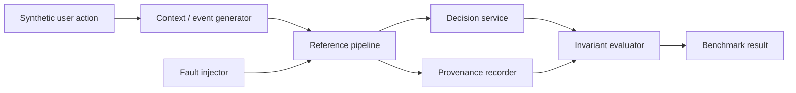

# IntentTrace Reference Architecture

**Status:** design draft. Updated as the reference implementation and benchmark results evolve.

## Purpose

IntentTrace studies information-integrity failures in distributed personalization, recommendation, and AI-enabled systems: the six information-integrity failure classes defined in [`failure-taxonomy.md`](failure-taxonomy.md), where services remain available and responsive while the resulting decision is incorrect or insufficiently grounded.

The reference architecture is intentionally small, synthetic, and deterministic so that failure scenarios can be reproduced from a clean checkout without proprietary infrastructure or data.

## Design principles

1. **Invariant first.** Every scenario starts with a correctness invariant that can be mechanically checked.
2. **Deterministic injection.** Faults use explicit configuration and seeds so the same scenario can be replayed.
3. **Decision-level provenance.** A result records the contextual inputs, versions, timing, and transformations that produced it.
4. **Synthetic and clean-room.** Workloads, reference components, and scenarios are independently constructed from public concepts.
5. **Framework neutral.** The core benchmark model does not depend on a commercial personalization or AI provider.
6. **Reproducible by default.** A clean checkout is sufficient to run the reference scenarios.

## Logical flow

## Components

### `generator/`
Planned: produces deterministic synthetic users, context versions, events, timestamps, and scenario inputs.

### `pipeline/`

Provides the clean-room reference path from versioned context to a decision.

The implementation separates context history from context resolution. `ContextStore` records the versions that were available at a decision boundary, while `ContextResolver` selects the version actually supplied to the decision path. This separation allows a benchmark to force an older read without rewriting the underlying history, so the decision can report both the state used and the latest state that was eligible.

### `injectors/`
The first implemented injector, `StaleContextResolver`, implements `ContextResolver` and selects an explicitly pinned older eligible context version for the decision path. It never modifies the underlying context history: `ContextStore` remains the source of benchmark ground truth and continues to report the true latest eligible version.

Invalid injection configurations fail immediately, including missing pinned versions, versions committed after the decision boundary, and versions that are not older than the latest eligible version. Additional injectors are planned for other failure classes.

### `evaluation/`

Results use the six-value `FailureClass` enum. Each value has an explicit canonical `id` for grouping and future serialization; `InvariantResult.failureClassId` derives that ID from the typed value.

`FreshnessInvariant` independently compares the decision's used and latest eligible context versions. `InvariantResult` records the canonical `stale-context` failure-class ID, expected and observed versions, an explanation, and one of `SATISFIED`, `VIOLATED`, or `NOT_APPLICABLE`. Missing either version makes freshness not applicable; it is not evidence of a fresh decision.

The result's `violated` property is derived from its status. Its separate nullable `detected` field records an observation supplied by the caller: `null` means no observation was supplied, `false` means the caller reported no detection, and `true` means the caller reported detection. Evaluation never infers a detection signal from ground truth, and permits false positives and false negatives to remain representable.

### `provenance/`

`ProvenanceRecorder` is called by a harness after decision and evaluation. It does not add fields to `Decision`, mutate context history, or introduce a pipeline dependency on recording. It checks that evaluation matches the recorded versions and that context evidence agrees with the store at the decision boundary.

`ProvenanceRecord` schema version 1 includes execution kind, decision identifiers, outcome and degradation reason, decision timestamp, expected invariant, used and latest eligible context snapshots, and evaluation evidence. Each context snapshot includes its commit timestamp and attributes. `ReproductionMetadata` holds scenario name/version, full source commit SHA, optional seed, runtime/JDK/OS, and configuration. Metadata is supplied explicitly by the caller rather than guessed from the recording environment.

Event ID, event time, and ingestion time remain null for this context-only scenario because those stages are not modeled. A null seed indicates no seed applies. The recorder snapshots configuration and context maps to prevent subsequent caller mutation from rewriting the evidence.

`ProvenanceJson` uses kotlinx.serialization with explicit canonical failure-class IDs, ISO-8601 timestamps, compact single-line JSON, and explicit null/default fields. Detection remains separate from invariant status. This provides the record format; file output and a standalone executable scenario remain follow-up work.

### `benchmarks/`
Planned: defines scenario configuration, expected invariants, execution harnesses, raw result formats, and reference results.

## Scenario contract

Every executable scenario must define:

- **Scenario ID** - stable machine-readable identifier for the scenario.
- **Failure class** - one canonical failure-class ID from
  [`failure-taxonomy.md`](failure-taxonomy.md).
- **Invariant** - the condition that must hold in a correct execution.
- **Control** - a healthy execution where the invariant holds.
- **Injection** - the deterministic change that creates the failure.
- **Decision boundary** - the point at which eligible context is evaluated for the decision.
- **Expected signature** - the observable evidence that the invariant was violated.
- **Detection rule** - how IntentTrace mechanically identifies the divergence.
- **Provenance requirements** - the minimum information needed to reconstruct the decision.
- **Reproduction metadata** - seed, configuration, environment, and source commit.

## Initial scenario: stale context

The first reference implementation targets the stale-context invariant already defined in [`failure-taxonomy.md`](failure-taxonomy.md):

> A decision reflects the most recent context committed before the decision point.

The paired tests in `StaleContextResolverTest` create context `v1` with category `travel` and then commit `v2` with category `technology`. Both versions are eligible at the explicit decision boundary. The same history is used for a normal control decision and an injected decision pinned to `v1`.

| Execution | Used version | Latest eligible version | Outcome | `freshnessViolated` |
|---|---|---|---|---|
| Control (`LatestEligibleContextResolver`) | v2 | v2 | technology | false |
| Injected (`StaleContextResolver`) | v1 | v2 | travel | true |

The store still reports `v2` as latest eligible after injection, and repeated executions produce identical decisions for the same inputs. The injected decision is not degraded: it uses available context, but that context is stale. `freshnessViolated` records benchmark ground truth; it does not mean that the evaluated system detected the problem. `FreshnessInvariant` independently evaluates the control as `SATISFIED` and injection as `VIOLATED`, with no detection observation supplied by either path. An end-to-end scenario runner remains planned.

## Error model

The reference pipeline distinguishes programming errors from information-integrity failures.

Programming errors and invalid benchmark construction fail immediately. Examples include blank identifiers, a resolver returning context for the wrong identity, a resolver returning context that is not part of the recorded history, and logically inconsistent context version ordering.

Information-integrity failures remain representable as successful decisions. Missing or unavailable context produces a degraded decision with an explicit `DegradationReason` rather than an infrastructure exception.

Staleness is different. `Decision.freshnessViolated` represents benchmark ground truth: the context actually used was not the latest context eligible at the decision boundary. It does not indicate that the system under test detected the violation.

Detection is evaluated separately from ground truth. A benchmark therefore distinguishes:

- whether an invariant was actually violated; and
- whether the system under test emitted a signal indicating that it noticed the violation.

Keeping those concepts separate allows IntentTrace to measure silent failures rather than treating knowledge available to the benchmark harness as knowledge available to the evaluated system.

## Non-goals

The reference implementation is not intended to:

- reproduce any proprietary production architecture;
- benchmark or rank commercial AI/model providers;
- replace general availability, latency, or infrastructure monitoring;
- claim that a synthetic scenario proves the prevalence of the corresponding failure in production systems.

## Evolution

Architecture changes require a scenario, reproducibility requirement, or independently observed usability need. Components are added when they make a failure measurable, reproducible, or easier to diagnose—not to increase the apparent size of the framework.
