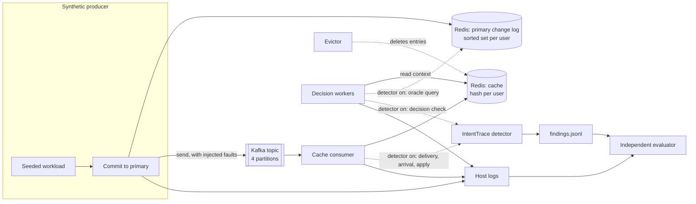

# System Benchmark: Kafka and Redis

**Status:** experimental. This is a **synthetic benchmark** on one machine. It shows how the
runtime detector behaves, and what it costs, under a controlled workload with known faults. It is
not production validation, and its numbers do not predict overhead or accuracy in any real system.

The [agreement run](detector.md#agreement-with-ground-truth) checks the detector on nine fixed
cases. This benchmark puts the same detector in a running data path, with a real broker and a real
store, and asks two questions:

1. **Cost.** How much latency, throughput, CPU, allocation and heap does the detector add to the
   host service?
2. **Detection.** Against ground truth derived independently from the host's own logs, how many
   failures does it find, and how many findings are wrong?

## What runs



- **Primary.** Each committed context version is added to a per-user sorted set in Redis, scored by
  commit time. The detector's oracle asks it for the latest version at or before a decision's
  timestamp, so the answer does not depend on when the check runs.
- **Kafka.** Each commit is then published, keyed by user, to a four-partition topic.
- **Cache consumer.** One consumer applies events to a per-user Redis hash in arrival order, as a
  simple consumer would. With the detector on, it follows the replay guard's verdict and reports
  arrivals and applications to the event-time monitor.
- **Decision workers.** Four threads serve decisions on a fixed schedule: read the user's cache
  entry, then, with the detector on, check the read.

Kafka 3.9.1 (KRaft, one node) and Redis 7.4.2 run from [compose.yaml](../system-benchmark/compose.yaml),
pinned by image digest. Each run uses a fresh topic and flushes its Redis database.

## Workload and injected faults

Every random choice derives from the seed, so each mode receives the same events, decisions,
faults and evictions on the same schedule.

| Setting | Default |
| --- | --- |
| Users | 10,000, chosen with a Zipf distribution (exponent 0.9), so a few users are hot |
| Context updates | 2,000 per second, Poisson arrivals |
| Decisions | 2,000 per second, Poisson arrivals, open loop |
| Phases | 15 s warmup, 30 s measured at the fixed rate, then 10 s closed-loop saturation |

| Fault | Rate | Effect |
| --- | --- | --- |
| Delayed send | 1% of updates, 150 ms late | Newer updates can overtake it; arrival-order processing then regresses state |
| Duplicate resend | 1% of updates, again after 80 ms | Same identity and payload delivered twice |
| Conflicting resend | 0.1% of updates, after 40 ms | Same identity reused for a different payload |
| Lost cache write | 0.5% of updates | The consumer silently skips the cache write, so later reads are stale |
| Cache eviction | 50 per second | The user's cache entry is deleted, so reads find nothing until the next update |

Ordinary propagation delay through Kafka also makes some reads stale, which is part of what the
benchmark measures.

## Modes

| Mode | Decision path | Event consumer |
| --- | --- | --- |
| `off` | No detector calls | No detector calls; every delivery is applied |
| `on` | Calls `checkDecision`, including the oracle query, before the decision returns | Calls `onDelivery`, `onArrival` and `onApplied`; skips deliveries the replay guard rejects |
| `on-async` | Hands the check to one background thread with a bounded queue and returns at once | Same as `on` |

The consumer always calls the detector inline, because the replay guard's verdict decides whether
a delivery is applied.

## What is measured

Each mode runs in a fresh JVM (`-Xms1g -Xmx1g`, G1). Repetitions rotate the order of the modes.

- **Decision latency** from each decision's scheduled time to its completion, so a backlog counts
  against the mode that caused it (no coordinated omission). **Service time** is from the start of
  the work.
- **Saturation throughput**: decisions per second with four threads issuing back to back.
- **CPU and allocation per operation**, from per-thread counters over the measured window. Work done
  by the background checker counts toward decisions.
- **Oracle call time** for every oracle query in the measured window.
- **Event propagation**: time from commit to the cache write.
- **Heap used after GC** once the run has stopped, with the detector still reachable.

## Ground truth

[`tools/evaluate_system_benchmark.py`](../tools/evaluate_system_benchmark.py) derives ground truth
from the host's own logs (commits, arrivals, applications and decisions) without the detector's
code or state, then compares it with `findings.jsonl`.

| Condition | Ground truth | Matched with |
| --- | --- | --- |
| Stale read at decision | The latest version committed at or before the decision is newer than the one read | `stale-context` finding for that decision |
| Missing context at decision | The decision read nothing although a version had been committed | `missing-context` finding for that decision |
| Older event replaced newer state | The consumer applied an event that occurred before the one it replaced | `stale-context` finding for that event |
| Duplicate delivery | An identity arrived again with the payload of its first arrival | `duplicate-replay` finding for that event |
| Reused identity, different payload | An identity arrived again with a different payload | `conflicting-values` finding for that event |
| Event arrived after a decision that needed it | The event occurred at or before the decision, was newer than what the decision reflected, and first arrived after it | `delayed-events` finding for that decision and event |

Repeats are counted, so a finding matches at most one instance of its condition. Decision-level
conditions are also reported separately for the fixed-rate and saturation phases.

## Run it

Needs Docker with Compose, JDK 17 or later, and Python 3.9 or later.

```bash
python3 tools/run_system_benchmark.py            # 3 repetitions of each mode, about 12 minutes
python3 tools/run_system_benchmark.py --smoke    # one short repetition, as in CI
```

Results go to `build/system-benchmark/`: one directory per run with its logs, `metrics.json` and
`evaluation.json`, plus `summary.json` and `summary.md` for all runs. Add `--down` to stop the
containers afterwards. The containers listen only on 127.0.0.1.

To score a single run again:

```bash
python3 tools/evaluate_system_benchmark.py build/system-benchmark/r1-on
```

## Results

Three repetitions of each mode at commit `eef5991`, on one host with 4 processors, Java 17 and
G1 with a 1 GiB heap, with Kafka and Redis in Docker on the same host. The full summary is in
[results/system-benchmark](results/system-benchmark/summary.md), with each metric's minimum and
maximum in `summary.json`.

### Cost

Medians across repetitions, with the range in brackets.

| Metric | Detector off | Inline checks | Off-path checks |
| --- | --- | --- | --- |
| Decision latency p50 | 188 µs (186 to 198) | 379 µs (367 to 391) | 198 µs (194 to 201) |
| Decision latency p99 | 1.62 ms (1.46 to 2.39) | 2.95 ms (2.52 to 2.96) | 2.24 ms (1.74 to 2.26) |
| Decision service time p99 | 909 µs (905 to 967) | 1.46 ms (1.38 to 1.47) | 918 µs (915 to 992) |
| CPU per decision | 77.7 µs | 110 µs | 122 µs |
| Saturation throughput | 20,487/s (20,460 to 21,125) | 10,214/s (9,811 to 10,694) | 18,835/s (18,093 to 19,698) |
| Oracle query p50 / p99 | n/a | 155 µs / 675 µs | 136 µs / 585 µs |
| Consumer CPU per event | 67.5 µs | 76.6 µs | 73.7 µs |
| Heap used after GC | 17.7 MiB | 83.9 MiB | 88.1 MiB |

The p99.9 latency varied widely between repetitions even with the detector off (4.3 to 19.2 ms),
so this setup cannot resolve the detector's effect on the extreme tail.

### Detection

Pooled across the three repetitions. Recall is split by the phase that issued the decision.

| Condition | Ground truth (inline) | Precision | Recall inline | Recall off-path, fixed rate | Recall off-path, saturation |
| --- | --- | --- | --- | --- | --- |
| Stale read at decision | 26,652 | 1.0000 | 0.9943 | 0.9992 | 0.1626 |
| Missing context at decision | 13,190 | 1.0000 | 1.0000 | 1.0000 | 0.4021 |
| Event arrived after a decision that needed it | 26,693 | 1.0000 | 0.9880 | 0.8518 | 0.0005 |
| Older event replaced newer state | 1,105 | 1.0000 | 1.0000 | 1.0000 (all phases) | |
| Duplicate delivery | 3,267 | 1.0000 | 1.0000 | 1.0000 (all phases) | |
| Reused identity, different payload | 300 | 1.0000 | 1.0000 | 1.0000 (all phases) | |

Precision was 1.0 in every condition and mode: no finding disagreed with the ground truth from
the host's logs.

### What the numbers show

- **The inline cost is mostly the oracle.** Checking a decision inline adds one Redis query to the
  decision path, about 155 µs at the median. That doubles median decision latency and halves
  saturation throughput. The detector's own CPU cost is about 32 µs per decision.
- **Off-path checks keep latency close to baseline** (median +5%, saturation throughput -8%). At
  the fixed rate they find almost every stale or missing read, because the oracle answers for the
  decision's own timestamp, however late the check runs.
- **Off-path checks miss late arrivals.** The decision is recorded with the event-time monitor only
  when its background check runs, so events that arrive in between cannot be attributed to it.
  Recall for late arrivals falls to 0.85 at the fixed rate. A host that wants both would need to
  record the decision inline and run only the oracle query off the path. The detector API does not
  separate those two steps yet.
- **An overloaded off-path checker loses coverage.** At saturation the single checker thread falls
  behind: its queue delay reached up to 8.7 s, and about 93,000 checks per run were dropped from
  the full queue. The primary keeps only the latest 64 versions per user, so late checks for hot
  users also lose their oracle answer. Drops are counted in `metrics.json`; a host would size the
  checker and alert on drops.
- **Idempotent processing prevents harm, not only reports it.** With the detector off, the
  consumer re-applied duplicates of older events, and state regressed 2,106 times. With the replay
  guard's verdict followed, it regressed 1,105 times. This is also why
  event propagation p99 is lower with the detector on: duplicates re-applied 80 ms later no longer
  count.
- **Retained memory is the detector's bounded state at its limits**: 100,000 tracked arrivals (the
  cap), about 110,000 replay identities within the 10-minute retention, and 64 recent decisions for
  each of 10,000 users. All three bounds are configurable.

### Why some conditions were missed inline

- **Stale reads (152 of 26,652).** In 151 of them, the newer version had been committed less than
  1 ms before the decision. The producer takes its commit timestamp just before the Redis write, so
  for that instant the version is committed by the log but not yet visible to the oracle.
- **Late arrivals (320 of 26,693), mostly at saturation.** About 93% were on the hottest user,
  which can receive more than 64 decisions while one event is delayed, so the decision falls out of
  the event-time monitor's per-key window. Separately, 39 of the 320 events arrived within 1 ms of
  the decision, a window in which the check may not yet have recorded it.

## Limits

- One host with 4 processors runs the JVM, Kafka and Redis together, so they compete for CPU.
  Absolute numbers depend on this machine; compare the modes with each other, not with other
  systems.
- One Kafka broker, one consumer thread and one Redis instance, which holds both the cache and the
  primary's change log. A separate primary would make the oracle query slower or faster.
- The version-lag tolerance is 0, so any lag counts as stale, including ordinary propagation
  delay. Hosts would normally set a tolerance.
- Ground truth trusts the host's logs, which record times from one clock. Clock skew between
  machines is not exercised.
- The off-path mode uses one checker thread and a 50,000-entry queue. Other sizes would change the
  saturation results.
- The workload, faults and rates are synthetic. They exercise the detector's checks; they do not
  represent any real system's traffic.
